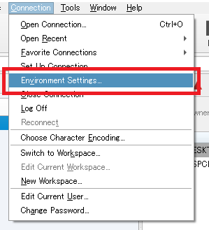
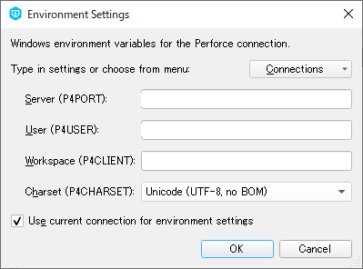
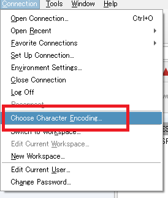
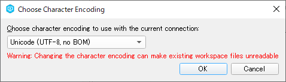
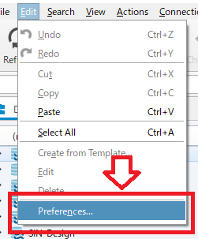
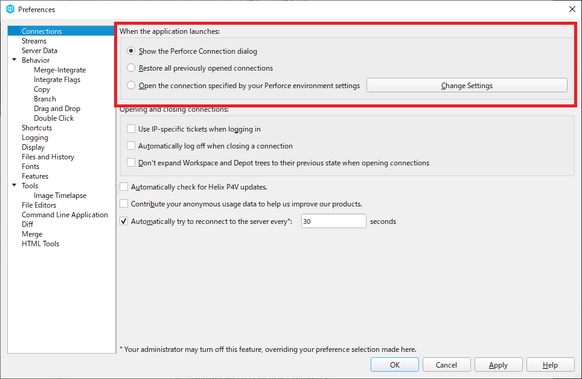

## 文字コードの設定

### ■ Environment Settings の確認

　

※ helix-p4d サーバー管理者に要確認
文字コードは、helix-p4dを構築しているサーバーに合わせる事

### ■ choose Character Encording の確認

　

※ helix-p4d サーバー管理者に要確認
文字コードは、helix-p4dを構築しているサーバーに合わせる事

## 起動時の設定

　

複数のプロジェクトを兼務する場合や、環境の切り替えをスムーズにするための設定です。

### 設定のポイント:

起動時に [Show the Open Connection dialog]（接続ダイアログを表示する）を有効にします

#### メリット:

前回終了時のサーバーに自動接続されるのを防ぎ、接続先ミスを未然に防止できます  
ワークスペースやユーザーを切り替えて作業する際に、間違いに気づきやすくなります  