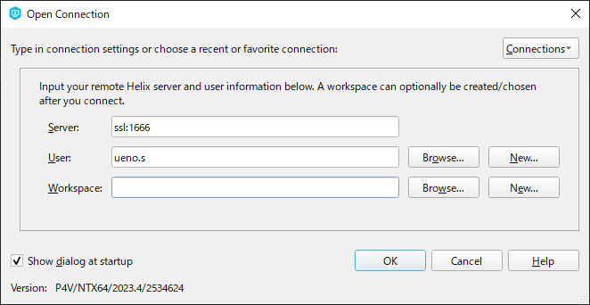
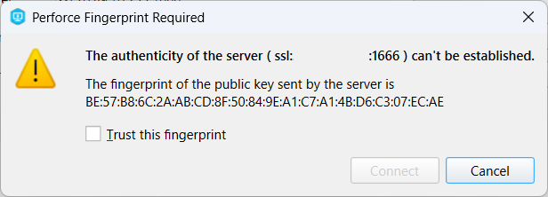



### ■ Server

Perforceサーバーのアドレスを入力する

### ■ User

Perforceアカウントを入力する

### ■ WorkSpace

`Browse...` を押して、WorkSpaceを選択する

## Trust This Fingerprintが表示されたら…？

Trust This Fingerprintにチェックを入れて、OKを押す

※ Trust This Fingerprintは表示されているが、別バージョンもあります