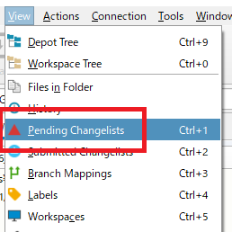
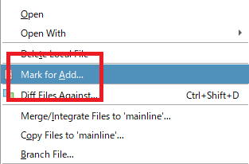
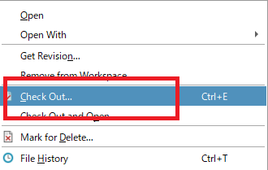
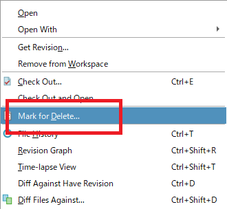
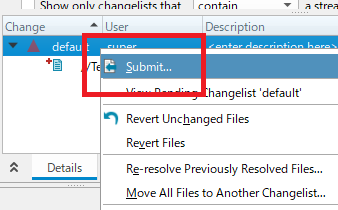

# Pending ChangeListのタブを開く

編集中のファイルは、このタブに表示される

# ファイルを追加する

追加したいファイルを選択して、Mark for Addを選択する

# ファイルを編集する

既にサーバーにサブミットされているファイルを編集するには、
編集したいファイルを選択して、右クリックを押し、CheckOutを選択する。

これで編集ができる状態になる。

# ファイルを削除する

削除したいファイルを選択してMark for Deleteを選択する

# サブミットする

