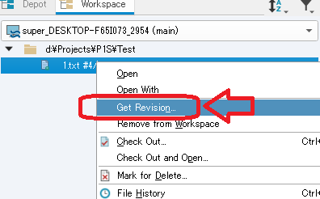
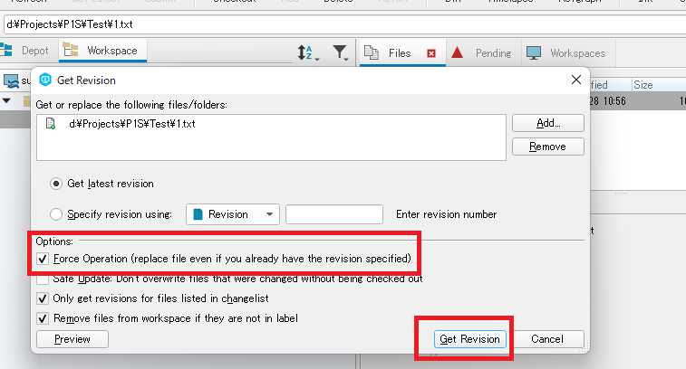

> [!NOTE]
> 1. 自分のPCローカルにあるファイルが何かが原因で紛失／消失した
> 2. 現在編集中のファイル を 元に戻す のが面倒で、 perforceサーバー上のファイルで戻したい

# 戻したいファイルがある大元のフォルダの選択

* 戻したいファイルの大元のフォルダを選択している状態で右クリック 
* GetRevisionを押す

# Optionsの設定にチェックをつける

* Force Operationにチェックをつけて、Get Revisionを押す

