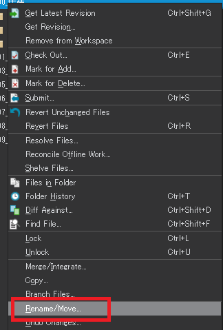
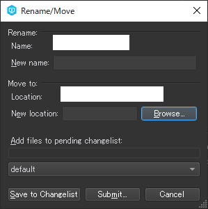

ファイル／フォルダの移動は`必ずP4Vを使って`ください。

SVNやGitと違って、Windowsエクスプローラー上でファイル移動をしても
元のファイル（フォルダ）を削除するサブミットをしないとサーバーに残るからです。

本項はP4Vを使ったファイル／フォルダの移動方法について説明します。

# Rename/move...を選択

変更したいフォルダを選択した上で、Rename/move...を選択します

これで名前変更を行うと元ファイルの削除と新しいファイルの追加を同時に行います。

# Rename/Move で変更する

## ファイル名を変更する場合

Renameの項目だけを編集

変更前の名前がNameに入力されているので、NewNameに新しい名前を入力

## フォルダの場所を移動する場合

Move toの項目だけ編集

変更前のファイル、フォルダの場所が、Locationに現在の場所が入力されているので、
NewLocationに新しい名前を入力する

# 編集が終わったらサブミットする

サブミットする