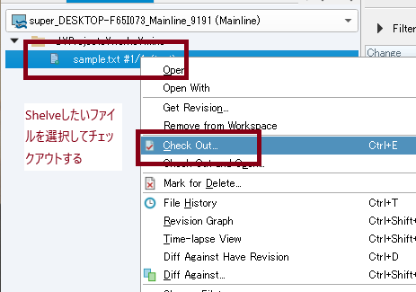
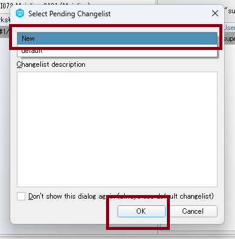
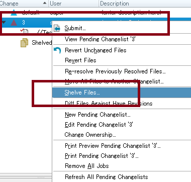
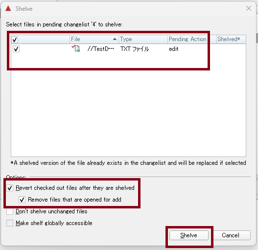
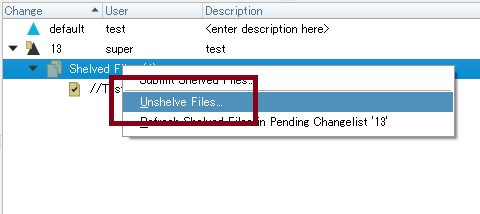
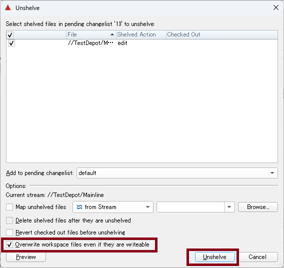
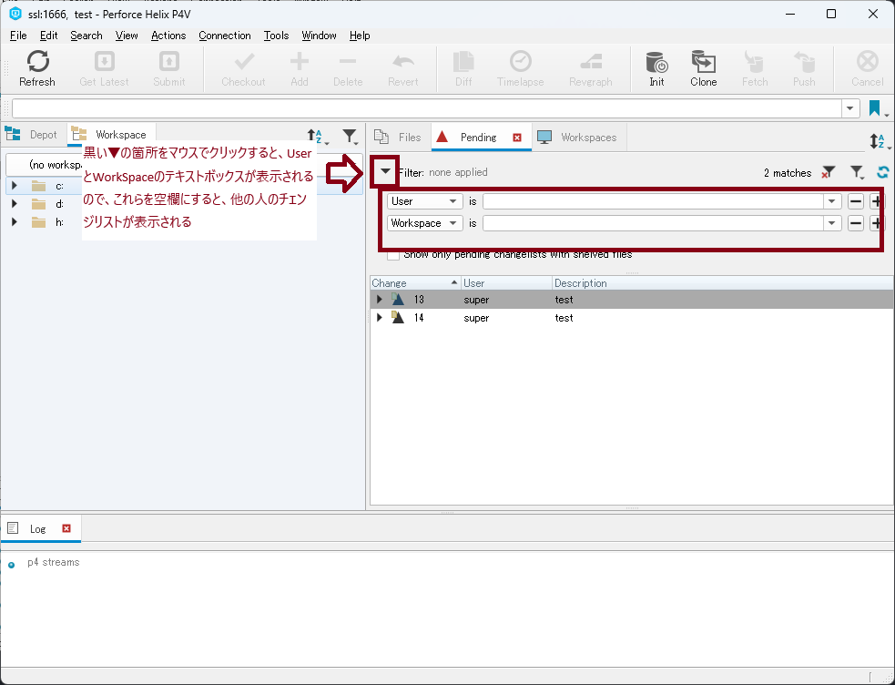
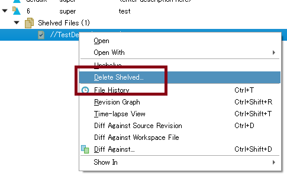

> [!NOTE]
> Perforceではサブミットをしないで、他の人にファイルを共有する事が可能です  
> その機能の事を `Shelve` と言います  

# チェックアウト

Shelveをするには、まずチェックアウトをします

defaultではなく、Newを選びましょう  
Shelveでファイルを共有するには、共有する相手から見えるようにチェンジリストに番号を割り振っておく必要があります

# Shelve する

チェンジリストを選択して、`Shelve Files...` を選択

２つチェックが入ってると思いますが、そのまま気にせずShelveを実行します  
※もし入ってなかったら入れてください

# Unshelve する

共有相手から、教えてもらったチェンジリストの番号を探して、Shelve状態のファイルがちゃんとある事を確認します  
そして、`Unshelve files...` を選択します  

Overwrite...~にチェックを入れて、Unshelveを選択します

自分のローカルにShelve状態のファイルが落ちてきます。

## 他の人が現在作業中のチェンジリストを確認するには？

UserとWorkSpaceの項目を空欄にしましょう

# ファイルの共有（Shelve）が終わったら…

Delete Shelved... を選択して、ファイルの共有状態を解除します

共有状態も無くしたチェンジリストは削除しておきましょう。
